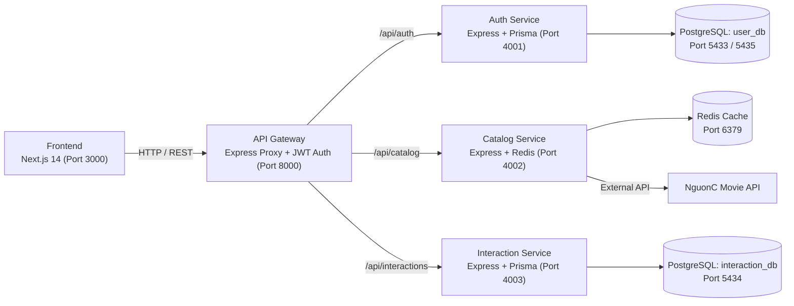
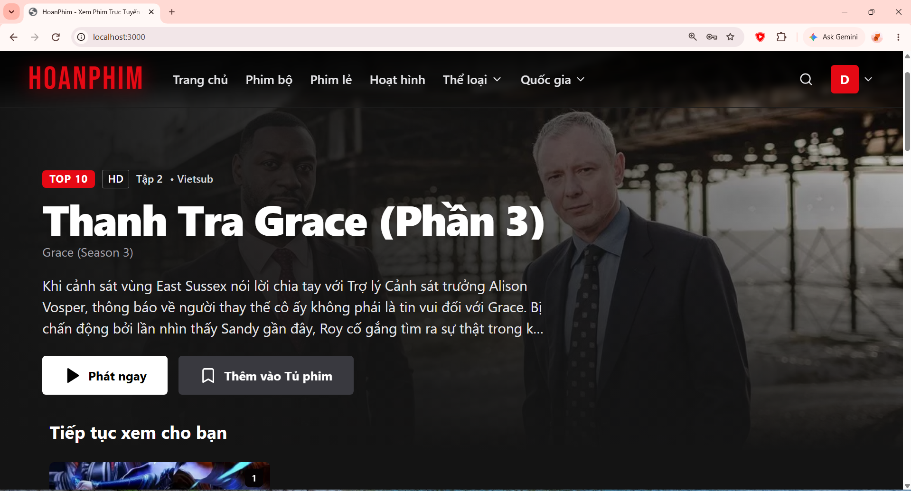

# 🎬 HoanPhim - Microservices Movie Streaming Platform

HoanPhim là nền tảng xem phim trực tuyến được xây dựng theo kiến trúc **Microservices Monorepo**, tách biệt hoàn toàn các dịch vụ nghiệp vụ, cơ sở dữ liệu độc lập (Database-per-Service), bộ nhớ đệm Redis và giao diện Cinema Dark UI tối ưu cho cả Desktop lẫn Mobile.

---

## 🏗️ System Architecture



---

## ✨ Engineering Highlights

- **API Gateway JWT Injection (`optionalAuth`)**: Xác thực JWT tập trung tại `api-gateway`, tự động giải mã thông tin người dùng (`userId`, `name`, `avatar`), loại bỏ header giả mạo từ client và truyền xuống các downstream services qua `x-user-*` headers.
- **Database-per-Service Pattern & Data Denormalization**: `auth-service` và `interaction-service` sở hữu 2 PostgreSQL database hoàn toàn độc lập. Dữ liệu tương tác (`Watchlist`, `WatchHistory`, `Comment`) được phi chuẩn hóa (`userName`, `userAvatar`, `movieName`, `thumbUrl`) để truy vấn nhanh mà không cần join chéo service.
- **Redis Cache-Aside & Request Aggregation (`Promise.all`)**: `catalog-service` áp dụng chiến lược Cache-Aside với `ioredis` (TTL = 1800s) và fail-open khi Redis gián đoạn; đồng thời gộp 5 danh sách phim trang chủ qua `Promise.all` tại `/home-feed` để giảm độ trễ tải trang.
- **Chunked Episode Pagination (>1.000 tập)**: Bộ chọn tập thông minh chia nhỏ danh sách tập theo từng cụm 100 tập (`1 - 100`, `101 - 200`, ...) kèm ô nhảy nhanh theo số tập, giúp trình duyệt render mượt mà với các bộ anime/phim dài tập như *One Piece* (1.180+ tập).
- **Cinema Dark UI & Responsive Touch UX**: Giao diện lấy cảm hứng từ Netflix với Hero Billboard, Swimlanes vuốt ngang mượt trên mobile, Cinema Mode (tắt đèn khi xem phim) và logo thương hiệu **HOANPHIM** dùng font *Bebas Neue*.

---

## 🛠️ Tech Stack

| Layer | Technology |
| :--- | :--- |
| **Frontend** | Next.js 14 (App Router), React 18, TypeScript, Tailwind CSS, Lucide React |
| **API Gateway** | Node.js, Express, `http-proxy-middleware`, `jsonwebtoken`, CORS |
| **Auth Service** | Node.js, Express, TypeScript, Prisma ORM, `bcryptjs`, JWT, PostgreSQL |
| **Catalog Service** | Node.js, Express, TypeScript, `ioredis`, Redis 7 |
| **Interaction Service** | Node.js, Express, TypeScript, Prisma ORM, PostgreSQL |
| **Infrastructure** | Docker Compose (PostgreSQL 16 Alpine x2, Redis 7 Alpine), Concurrently |

---

## 📸 Screenshots

| Home Page (Billboard & Swimlanes) | Cinema Player & Chunked Episodes |
| :---: | :---: |
|  |  |

---

## 🚀 Quick Start

Đảm bảo máy đã cài đặt **Docker Desktop** và **Node.js >= 18**.

```bash
# 1. Khởi động 2 PostgreSQL databases và Redis Cache
docker compose up -d

# 2. Cài đặt dependencies cho toàn bộ Monorepo (Gateway, 3 Services, Frontend)
npm run install-all

# 3. Đồng bộ Prisma schema vào 2 database độc lập
npm run db-push

# 4. Khởi chạy đồng thời tất cả 5 services ở chế độ development
npm run dev
```

Sau khi khởi chạy thành công:
- **Frontend**: http://localhost:3000
- **API Gateway**: http://localhost:8000
- **Auth Service**: http://localhost:4001
- **Catalog Service**: http://localhost:4002
- **Interaction Service**: http://localhost:4003
